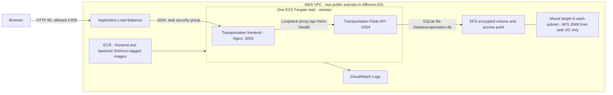
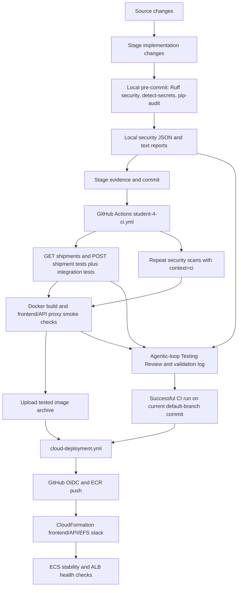

# Transportation deployment, security testing, and Testing Review

This implementation covers `student-4-sam`. The other students retain their own workflows. The old cloud workflow listed five ECS services but called a missing deployment script; the replacement provisions a complete transportation deployment rather than claiming the other modules have been deployed.

## AWS reference architecture



The database remains SQLite, matching the application. EFS persists it across task replacement; the file system is retained on stack deletion. This is a single-task demonstration architecture, with stop-before-start deployment to avoid running multiple SQLite writers and a short deployment outage. It is not a scale-out database architecture. The existing application has no user authentication; restrict `ALLOWED_CIDR` to the demonstration audience. The template uses HTTP; an internet production deployment would need authentication and an HTTPS listener/certificate.

The task execution role permits ECR pulls and log delivery. The deployment OIDC role needs permissions for ECR describe/create/push, CloudFormation stack operations, the ECS/EC2/ELB/EFS/Logs resources in the template, and `iam:PassRole` for the task execution role. The VPC needs DNS resolution/hostnames and two public subnets in different availability zones, routed through an internet gateway. Tasks use public IPs for outbound image pulls; only the ALB can reach frontend port 3004. The API port is not exposed by the task security group.

The cloud stack starts the operational transportation app. Ollama, RAG, the standalone MCP server, and shared multi-agent Python processes are not deployed. `MULTI_AGENT_ENABLED=false` in the task definition disables shared workflows. Other AI buttons may report unavailable services; this deployment does not claim cloud AI integration.

## DevOps deployment flow



## Local pre-commit security evidence

Install pre-commit in your development environment and enable its hook:

```bash
python3 -m pip install pre-commit
pre-commit install
```

Stage implementation changes first. The three transportation hooks also run during a normal commit, even when no requirements file changed. To generate the evidence before committing, run them explicitly:

```bash
pre-commit run transportation-ruff-report --all-files
pre-commit run transportation-secrets-report --all-files
pre-commit run transportation-audit-report --all-files
```

The hooks write these files under `student-4-sam/evidence/`:

- `security-ruff.json`, `security-detect-secrets.json`, `security-pip-audit.json`: actual command, output, timestamp, context, source index fingerprint, and exit status.
- `pre-commit-report.json` and `pre-commit-report.txt`: combined security testing report.

Stage these five report files with the implementation. Evidence files are excluded from the source fingerprint so adding the reports does not invalidate the source they describe. Hooks preserve identical scan records so the final commit does not endlessly change report timestamps. If you change or stage more implementation files, rerun all three hooks and stage the refreshed reports. Existing repository hooks also run during a commit, including the order-management checks; this change retains those hooks.

The source fingerprint hashes Git index entries for transportation and its pipeline/review files, rather than the parent commit ID. Thus a report produced before committing can match the checkout of the resulting commit. Do not use unstaged source when collecting submission evidence. Reports produced directly with `security_report.py` default to `local-manual` and cannot satisfy the local-pre-commit requirement.

Scanner errors and dependency/network failures fail the hook. `detect-secrets scan` findings are explicitly treated as failures even though that tool's scan command normally exits zero. Transportation auditing does not apply the shared script's advisory exemptions.

## Post-commit tests and reports

The assigned workflow is [student-4-ci.yml](../.github/workflows/student-4-ci.yml). Its two core backend functions are:

| Function | Endpoint | Assertions |
| --- | --- | --- |
| `get_shipments` | `GET /api/shipments` | Empty list, JSON response, persisted records, descending IDs |
| `create_shipment` | `POST /api/shipments` | HTTP 201, persisted field values, default status/delay, status normalisation, HTTP 400 for invalid input without inserting rows |

Contract tests use a new temporary SQLite database per test and do not require running cloud/AI services. Existing MCP, multi-agent, and URL tests are retained. Evidence validation tests check stale, missing, skipped, and incorrectly attributed scanner reports.

Run the same suite locally:

```bash
python3 -m pip install -r scripts/transportation/requirements-test.txt
python3 scripts/transportation/test_report.py
```

Local runs record `context=local-test`; they do not claim to be post-commit CI evidence. CI creates `post-commit-report.json`, `student-4-test-results.txt`, and `transportation-tests.xml`, records the commit and Actions run URL, and uploads them even when tests fail. Additional artifacts contain CI security output, Docker build/smoke logs, and the tested image archive. CI scans are stored separately from the committed local pre-commit report.

## Shared agentic-loop Testing Review

The existing interactive shared loop still supports the other modules and review categories. Transportation `testing` now reads actual report JSON before generating a review; source code and workflow definitions alone cannot establish a passing test result.

In CI the loop runs deterministically without Ollama:

```bash
python3 agentic-review/review_loop.py --student student-4-sam --category testing --offline
```

It produces `testing-review.md` (PLAN, ACT, OBSERVE, ADAPT) and `testing-validation.json` (individual validation results and SHA-256 hashes of both input reports). It checks all three successful local hook results, matching source fingerprints, a successful CI suite, both endpoint contract tests, and Docker validation status when supplied by CI. Missing or stale local reports make CI's Testing Review fail and prevent cloud deployment.

For a model assessment followed by a second model's validation, omit `--offline` with Ollama running. The same deterministic checks still run first; model failures are recorded. When reviewing downloaded CI artifacts locally, merge the current local security reports and the downloaded post-commit report into an evidence directory and pass `--evidence-dir PATH`. Do not overwrite the CI report with a local test run. The shared `agentic_review_log.jsonl` also records the review result.

## AWS setup and deployment

Configure repository/environment variables:

| Variable | Value |
| --- | --- |
| `AWS_REGION` | AWS region, defaults to `ap-southeast-2` |
| `VPC_ID` | Existing VPC ID |
| `PUBLIC_SUBNET_IDS` | Exactly two comma-separated public subnet IDs in different AZs |
| `TASK_EXECUTION_ROLE_ARN` | Existing ECS task execution role |
| `ALLOWED_CIDR` | IPv4 CIDR allowed to use the application |

Set the `AWS_DEPLOY_ROLE_ARN` secret to the deployment role. Configure its OIDC trust for the repository and `aws-transportation` GitHub environment. The AWS connection test has separate `AWS_ROLE_ARN`/`AWS_REGION` variables and does not replace this deployment role setup.

A successful transportation push CI run on `main` triggers cloud deployment. If your default branch has a different name, update the `workflow_run.branches` filter. Alternatively, dispatch Cloud Deployment with the successful CI run ID, selecting that same default-branch commit. The workflow verifies the run's workflow file, successful conclusion, push event, repository, branch, and SHA against the current default branch. Pull-request artifacts are never deployed.

Cloud deployment downloads the image archive from that exact successful run, loads it, and pushes SHA/run-tagged frontend and backend images to ECR. It deploys [the CloudFormation template](../scripts/deploy/transportation.yml), waits for ECS stability, and verifies the primary deployment reached `COMPLETED` with the desired running count. ALB health checks probe `/health` through Nginx to Flask. The application URL and resource state appear in the `transportation-cloud-deployment` artifact. `ALLOWED_CIDR` may exclude GitHub-hosted runners, so validation relies on AWS health checks rather than pretending the runner can reach a restricted browser endpoint.

Actual post-commit reports and cloud deployment evidence require running GitHub Actions and AWS; locally generated reports must not be presented as those runs.

Reference: [AWS ECS deployment action guidance](https://github.com/aws-actions/amazon-ecs-deploy-task-definition) describes task-definition deployment, Fargate `awsvpc` networking, and waiting for service stability. This implementation uses the AWS CLI and CloudFormation for the equivalent deployment and stability checks.
